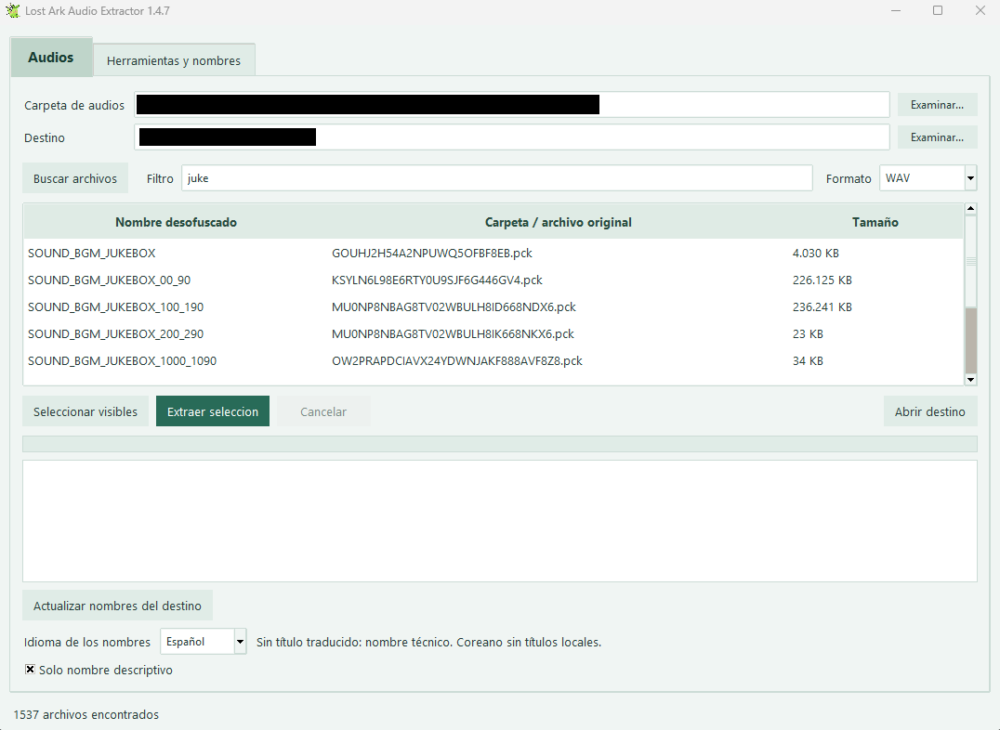
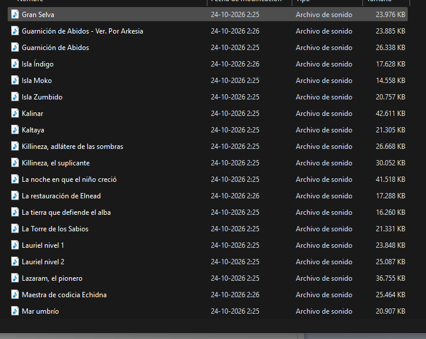
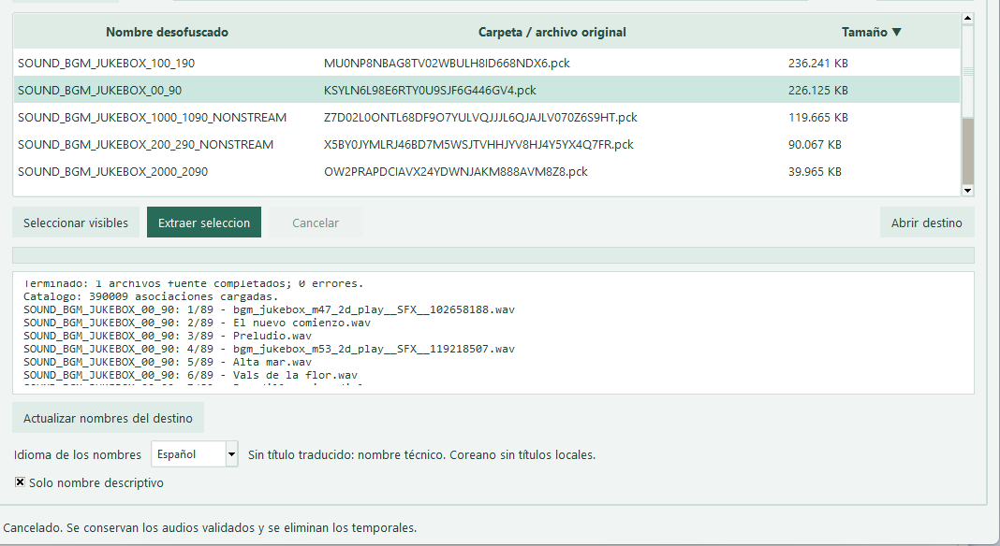
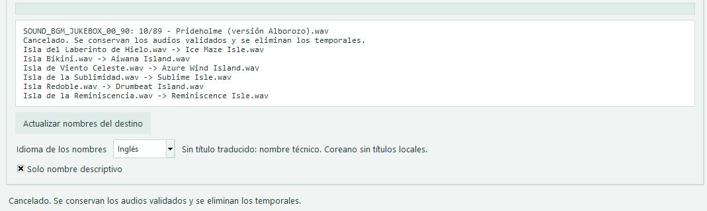

# Lost Ark Audio Extractor — 1.4.7

Extrae música, voces y efectos de Lost Ark desde archivos **PCK/WEM** y los convierte a **WAV, MP3 o ambos**. Funciona localmente en Windows y no modifica los archivos originales.

## Uso rápido

1. Abre `LoaAudioExtractor-1.4.7.exe` (no requiere Python).
2. Elige la **Carpeta de audios** y un **Destino** separado.
3. Pulsa **Buscar archivos** y selecciona los que quieres extraer.
4. Elige el formato, el idioma de los nombres y, opcionalmente, **Solo nombre descriptivo**.
5. Pulsa **Extraer selección** y después **Abrir destino**.

## Funciones

| Opción | Qué hace |
| --- | --- |
| Buscar archivos / Filtro | Lista los archivos compatibles y permite buscarlos. |
| Seleccionar visibles | Selecciona todos los resultados del filtro. |
| Formato | Exporta a WAV, MP3 o WAV + MP3. |
| Idioma de los nombres | Elige títulos en español, inglés o coreano; no cambia el idioma del audio. |
| Solo nombre descriptivo | Guarda nombres como `Aldea de las Nia.wav`. Los duplicados reciben `_2`, `_3`, etc. |
| Extraer selección / Cancelar | Inicia o detiene la extracción. Al repetirla, reutiliza los resultados registrados. |
| Actualizar nombres del destino | Renombra audios registrados sin reconvertirlos; aplica el idioma y estilo elegidos. |
| Abrir destino | Abre la carpeta de resultados. |
| Herramientas y nombres | Configura y verifica herramientas; permite usar inventarios y catálogos CSV opcionales. |

## Screenshots

### Main interface
Search and select audio files to extract.

### Extracted audio
Output files with descriptive names.

### Audio extraction
Extraction progress and filename options.

### Filename language
Update existing filenames from Spanish to English without converting the audio again.

## Nombres y organización

- Recupera nombres de archivos compatibles y usa un diccionario de eventos y títulos.
- Organiza la salida por nombre desofuscado y archivo original de procedencia.
- Nombre completo: `Aldea de las Nia__bgm_jukebox_m36_2d_play__SFX__755910078.wav`.
- Sin título disponible, conserva el nombre técnico; sin evento identificado, usa `sin_evento` con idioma e ID.
- **Coreano:** el selector está disponible, pero las bases incluidas aún no contienen títulos coreanos.
- Deja **Catálogo CSV** vacío para utilizar el diccionario integrado en el EXE. Conserva `.loa_audio` para reanudar y actualizar nombres.

Código bajo licencia **MIT**. Proyecto independiente, sin afiliación oficial con Lost Ark.

__________________________________________________________________________________________________

# Lost Ark Audio Extractor — 1.4.7

Extract music, voices, and sound effects from Lost Ark **PCK/WEM** files and convert them to **WAV, MP3, or both**. Runs locally on Windows without modifying the original files.

## Quick start

1. Open `LoaAudioExtractor-1.4.7.exe` (no Python installation required).
2. Select the **Audio folder** and a separate **Destination**.
3. Click **Find files** and select the files you want to extract.
4. Choose the output format, filename language, and optionally **Descriptive name only**.
5. Click **Extract selection**, then **Open destination**.

*The control names used here are English translations of the Spanish interface labels.*

## Features

| Option | What it does |
| --- | --- |
| Find files / Filter | Lists supported files and lets you search them. |
| Select visible | Selects all results matching the filter. |
| Format | Exports to WAV, MP3, or WAV + MP3. |
| Filename language | Selects Spanish, English, or Korean titles; does not change the audio language. |
| Descriptive name only | Saves filenames such as `Nia Village.wav`. Duplicate names receive `_2`, `_3`, etc. |
| Extract selection / Cancel | Starts or stops extraction. Running it again reuses previously recorded results. |
| Update destination filenames | Renames tracked audio files without converting them again, applying the selected language and naming style. |
| Open destination | Opens the output folder. |
| Tools and names | Configures and checks tools; supports optional CSV inventories and catalogs. |

## Screenshots

### Main interface
Search and select audio files to extract.

### Extracted audio
Output files with descriptive names.

### Audio extraction
Extraction progress and filename options.

### Filename language
Update existing filenames from Spanish to English without converting the audio again.

## Filenames and organization

- Recovers supported filenames and uses a dictionary of events and titles.
- Organizes output by deobfuscated name and original source file.
- Full filename example with a Spanish title: `Aldea de las Nia__bgm_jukebox_m36_2d_play__SFX__755910078.wav`.
- When no title is available, the technical name is preserved. When no event is identified, the filename uses `sin_evento` (“no event”) with the language and ID.
- **Korean:** the option is available, but the included databases do not yet contain Korean titles.
- Leave **Catalog CSV** empty to use the dictionary bundled with the executable. Keep the `.loa_audio` folder to resume extraction and update filenames.

Code licensed under **MIT**. An independent project with no official affiliation with Lost Ark.
